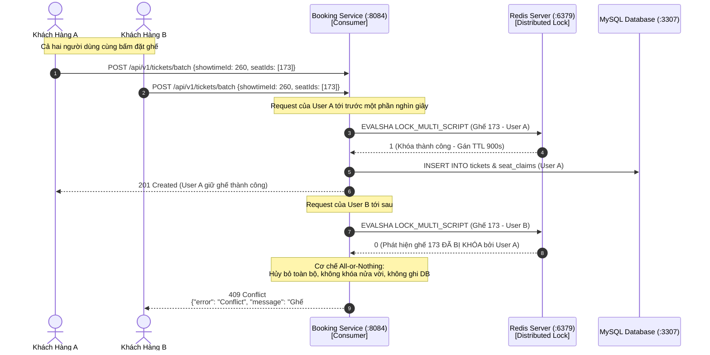

# SƠ ĐỒ TUẦN TỰ: XỬ LÝ XUNG ĐỘT GHẾ (SEAT CONFLICT - 409)
## BÀI THỰC HÀNH SỐ 6 - TÍCH HỢP VÀ TIÊU THỤ DỊCH VỤ

Sơ đồ thể hiện cách hệ thống xử lý tình huống hai khách hàng cùng chọn đặt trùng một ghế tại cùng một suất chiếu, minh họa cơ chế **All-or-Nothing** bằng Redis Lua Script và mã phản hồi chuẩn `409 Conflict`.

---

## 1. Sơ đồ Mermaid (Sequence Diagram)

---

## 2. Diễn giải cơ chế chống Race Condition

1. **Vấn đề thực tế:** Khi phim "hot" mở bán, hàng trăm người dùng có thể cùng chọn một vị trí ghế VIP hoặc SWEETBOX trong cùng một giây. Nếu kiểm tra ghế bằng câu lệnh `SELECT ... WHERE status = 'AVAILABLE'` thông thường trong SQL, hiện tượng **Race Condition** sẽ xảy ra (cả 2 người đều thấy ghế trống và cùng tạo vé).
2. **Giải pháp Redis Lua Script:**
   - Lệnh Lua chạy hoàn toàn nguyên tử (Single-threaded) trên Redis.
   - Script duyệt qua mảng danh sách ghế: nếu bất kỳ ghế nào đã tồn tại khóa `lock:showtime:{id}:seat:{seatId}`, script lập tức dừng lại và trả về mã lỗi kèm danh sách ghế bị trùng.
   - Không có bất kỳ ghế nào của User B bị giữ lại nửa vời (All-or-Nothing).
3. **Mã lỗi HTTP 409 Conflict:**
   - `Booking Service` bắt kết quả từ chối của Redis và ném ngoại lệ `ConflictException`.
   - `GlobalExceptionHandler` format thành cấu trúc JSON chuẩn `409 Conflict`.
   - Giao diện Client hiển thị Toast thông báo đỏ: *"Ghế này vừa được người khác giữ hoặc đã bán! Vui lòng chọn ghế khác."*
