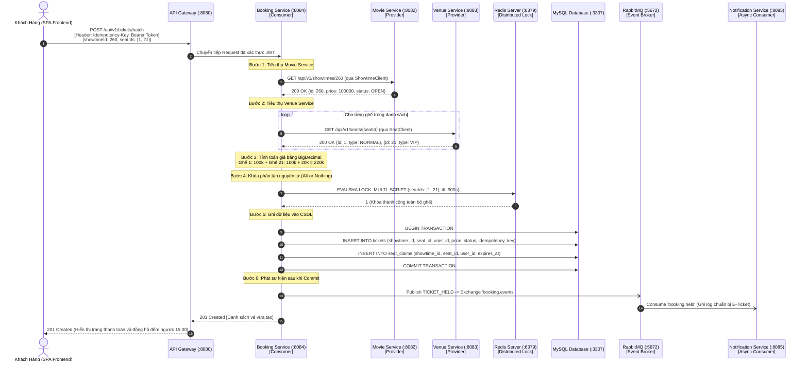

# SƠ ĐỒ TUẦN TỰ: ĐẶT VÉ NGUYÊN TỬ THÀNH CÔNG (HAPPY PATH)
## BÀI THỰC HÀNH SỐ 6 - TÍCH HỢP VÀ TIÊU THỤ DỊCH VỤ

Sơ đồ thể hiện quy trình tích hợp giữa Client, API Gateway, Booking Service (Consumer), Movie Service (Provider), Venue Service (Provider), Redis Cache, MySQL và RabbitMQ trong kịch bản đặt vé thành công.

---

## 1. Sơ đồ Mermaid (Sequence Diagram)

---

## 2. Diễn giải các bước nghiệp vụ

1. **Client** gửi yêu cầu đặt nhiều ghế trong 1 đơn hàng qua API Gateway kèm mã `Idempotency-Key` (UUID) để đảm bảo không bị trừ tiền 2 lần.
2. **Booking Service (Consumer)** đóng vai trò trung tâm điều phối, lần lượt gọi:
   - `ShowtimeClient` gọi sang `Movie Service` để xác thực suất chiếu còn mở bán và lấy giá vé cơ bản (100.000 ₫).
   - `SeatClient` gọi sang `Venue Service` để lấy loại ghế (Ghế #1 là Ghế Thường, Ghế #21 là Ghế VIP).
3. **Tính toán tiền tệ:** Sử dụng `TicketRules.calculatePriceBigDecimal` áp dụng phụ thu VIP (+20.000 ₫), tổng thanh toán là 220.000 ₫ (loại bỏ sai số số thực).
4. **Khóa nguyên tử (Atomic Lock):** Sử dụng Redis Lua script để kiểm tra và giữ cả 2 ghế cùng lúc. Nếu 1 trong 2 ghế đã có người giữ thì không khóa ghế nào.
5. **Giao dịch SQL:** Lưu vé vào bảng `tickets` và bảng `seat_claims` với thời hạn giữ chỗ 15 phút.
6. **Bắn tin nhắn RabbitMQ:** Sử dụng `afterCommit()` để đảm bảo khi cơ sở dữ liệu đã commit an toàn thì sự kiện `TICKET_HELD` mới được phát sang RabbitMQ.
7. **Phản hồi:** Trả về HTTP `201 Created` cho người dùng kèm danh sách mã vé.
