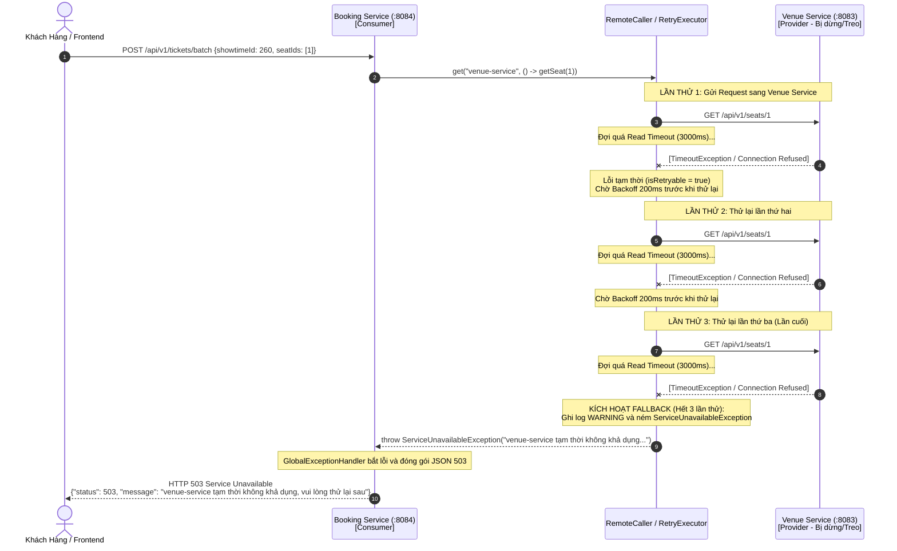

# SƠ ĐỒ TUẦN TỰ: KHẢ NĂNG CHỊU LỖI (RESILIENCE: TIMEOUT, RETRY, FALLBACK)
## BÀI THỰC HÀNH SỐ 6 - TÍCH HỢP VÀ TIÊU THỤ DỊCH VỤ

Sơ đồ thể hiện cách hệ thống ứng phó khi một dịch vụ Provider (`venue-service` hoặc `movie-service`) bị sự cố mạng, quá tải hoặc dừng hoạt động (Down). Minh họa cơ chế **Connect/Read Timeout**, **Retry 3 lần với Backoff 200ms**, và **Fallback trả về mã HTTP 503 Service Unavailable** (Fail-Closed).

---

## 1. Sơ đồ Mermaid (Sequence Diagram)

---

## 2. Diễn giải cơ chế Chịu lỗi (Resilience Explanation)

1. **Ngăn chặn Cascading Failure (Suy sập dây chuyền):**
   - Nếu không cấu hình Timeout, khi `venue-service` bị treo, các luồng (thread) xử lý của `booking-service` sẽ bị giữ vô thời hạn. Hàng trăm yêu cầu dồn đến sẽ làm cạn kiệt Tomcat thread pool, dẫn đến `booking-service` cũng bị sập theo.
   - Bằng cách đặt `connectTimeout = 2000ms` và `readTimeout = 3000ms`, luồng được giải phóng ngay khi vượt quá ngưỡng chịu đựng.
2. **Khả năng tự phục hồi (Self-Healing qua Retry Pattern):**
   - Trong môi trường phân tán, các sự cố mạng chập chờn thường chỉ kéo dài vài phần trăm giây. Lần thử lại sau 200ms giúp hệ thống tự phục hồi thành công mà người dùng không hề hay biết.
3. **Giới hạn số lần thử (Max Attempts = 3):**
   - Chỉ retry tối đa 3 lần để tránh tạo thêm tải (Thundering Herd) lên dịch vụ Provider đang gặp sự cố.
4. **Cơ chế Fail-Closed an toàn tuyệt đối:**
   - Khi dịch vụ phòng chiếu chết, hệ thống từ chối xuất vé (HTTP 503) thay vì tự ý gán giá vé mặc định, tránh việc bán vé sai phòng hoặc sai loại ghế.
